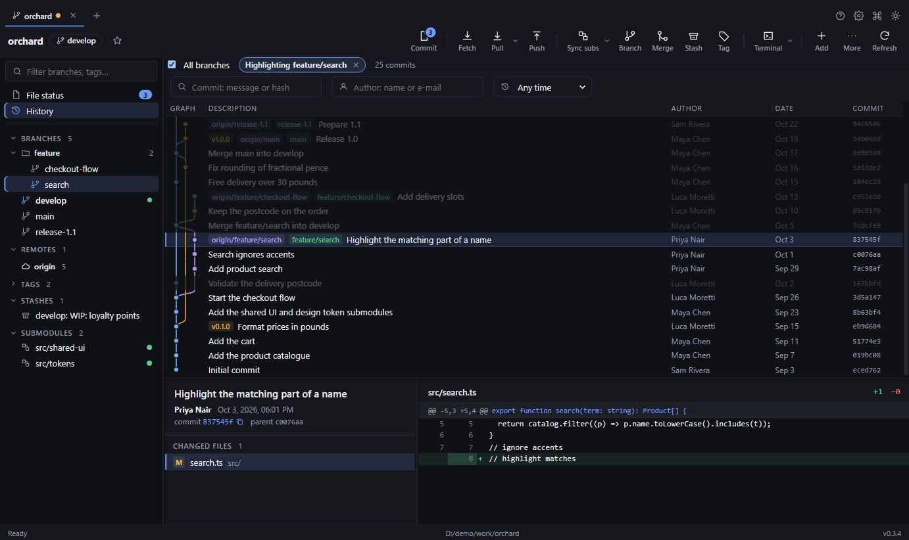

# Treeline

A fast desktop Git client with styled interface. It talks to the system `git` CLI, so it works
with **any Git remote** (self-hosted, GitLab, Gitea, Azure DevOps, a bare repo on a file share …). There are
no provider integrations and no sign-in.

Built with **Tauri 2** (Rust) and **React + TypeScript**.



> **New here? Read the [User Guide](docs/USER_GUIDE.md)** — a step-by-step walkthrough of every feature, what each error
> means and how to fix it. It is also built into the app (press `F1`).

> ### ⚠️ Platform status — Linux help wanted
> | | Status |
> | --- | --- |
> | **Windows 10** | ✅ Built, installer produced, and every feature exercised by hand |
> | **macOS (Apple Silicon)** | ✅ Installer built by the release workflow, and every feature exercised by hand |
> | **macOS (Intel)** | ⚠️ Installer is built by the release workflow, but it has not been tested on an Intel Mac. |
> | **Linux** | ❌ **Not tested.** `.AppImage`, `.deb` and `.rpm` installers are built by the release workflow, but they have never been run. |
>
> **We need your help to test it on Linux and on Intel Macs** — see [Help us test](#help-us-test-on-macos-and-linux). Windows 11 is
> expected to work but has not been checked either. Until this is verified, treat Linux as unsupported.

> ### 🙋 Want to help? Anyone is welcome.
> This is a young project and it needs people. You don't have to be a Git or Rust expert, and every bit counts:
> **try it on a Mac or Linux machine** (15 minutes, no coding), **report a bug or an idea**, **fix a typo**, **improve the
> docs**, or **send code**. Start with [Help us test](#help-us-test-on-macos-and-linux) or [CONTRIBUTING.md](CONTRIBUTING.md) —
> and if you're not sure where to begin, just open an issue and say hello.

## Install

Download the installer for your system from the **[latest release](https://github.com/suhailaleryani/treeline/releases/latest)**:

| OS | Download | Notes |
| --- | --- | --- |
| **Windows 10/11** | `…-setup.exe` (or `.msi`) | Unsigned: SmartScreen → **More info → Run anyway** |
| **macOS 12+** | `.dmg` (`aarch64` = Apple Silicon, `x64` = Intel) | Unsigned: right-click the app → **Open** once |
| **Linux** | `.AppImage` (`chmod +x`, run), `.deb` (`sudo apt install ./file.deb`) or `.rpm` | Needs WebKitGTK 4.1 |

Install [Git 2.30+](https://git-scm.com) first. Full steps are in the [User Guide](docs/USER_GUIDE.md#installing-treeline).
Linux builds and Intel Mac builds are untested (see the status table above). Prefer to build it yourself? See [Build installers](#build-installers).

## Features

| Area | What you get |
| --- | --- |
| **Tabs** | Many repositories open at once. Only the active tab is refreshed. Local changes are picked up by a file watcher (no polling), and the active tab is fetched silently in the background (every 2 minutes by default; configurable in Settings) so merges and pushes made on the server show up by themselves. Tabs are restored on start-up. |
| **Bookmarks** | Star a repository to keep it one click away on the home tab and in the command palette. |
| **Clone** | Any URL, live progress, optional submodules. A clone whose only failure is a submodule still opens, with a warning. |
| **Submodules** | Shown in the sidebar with status, opened in their own tab beside the parent (double-click), initialised on demand, bulk update, and **one click to switch every submodule to the same branch name** as the parent (*Sync subs*). |
| **Working copy** | Stage/unstage/discard per file, **per hunk, or per line**. Commit, amend, commit & push. |
| **History** | Virtualised commit graph (smooth with 10k+ commits), search, all-branches toggle, **click a branch to highlight its history**, uncommitted-changes row, commit detail and per-file diff in a panel that always stays on screen, with a resizable message box. |
| **Branches & tags** | Create, check out, rename, delete (local and remote), tag, push tag. Fetch / pull / push a single branch from its right-click menu. |
| **Updates** | A small dot on the Settings button appears when a newer version of Treeline is available (checked at start-up and every 6 hours); nothing installs until you confirm. |
| **Remotes** | Automatic background fetch of the active tab (every 2 minutes by default; choose 15 seconds to 30 minutes, or off, in Settings; silent). Fetch, pull (merge / rebase / fast-forward only), push (upstream, tags, force-with-lease) with progress. |
| **Merge tools** | Merge (`--no-ff`, squash), rebase, **interactive rebase** (pick/reword/edit/squash/fixup/drop, reorder), cherry-pick, revert, reset, stash, and a **conflict resolver** with per-conflict ours/theirs/both and an editable result; buttons explain themselves on hover and name the real branches. |
| **Merge to many** | Merge one branch (a bug fix, say) into several release branches at once. Every merge is test-run first, so you see which are clean and which would conflict, and in which files, before anything changes. Resolve a conflicting branch, resume, and **reuse your resolution** on the others; merges that silently dropped your change are flagged. |
| **Security** | Asks before opening a repository whose own settings or hooks can run programs, works only on folders you opened, hides credentials in messages, refuses writes through symbolic links, uses a strict content policy and verifies signed updates. See [SECURITY.md](SECURITY.md). |
| **Errors that help** | Every failure is explained in plain language with numbered fixes and one-click actions (Pull, Stash, Remove lock file …). Risky "force" options are offered last and always confirmed first. |
| **UX** | Command palette, context menus, dark/light theme, resizable panes, keyboard shortcuts, and the full user guide built in (`F1`, works offline). |

### Keyboard shortcuts

On macOS use `Cmd` in place of `Ctrl` (except `Ctrl+Tab`).

`Ctrl+K` command palette · `Ctrl+O` open repository · `Ctrl+T` new tab · `Ctrl+W` close tab ·
`Ctrl+Tab` / `Ctrl+Shift+Tab` next / previous tab · `Ctrl+R` refresh · `Ctrl+Enter` commit ·
`F1` or `Ctrl`/`Cmd`+`?` user guide.

## Why it is fast

* Every Git call runs on a worker thread; the UI never waits on a process.
* A refresh runs `status`, refs, stashes, remotes and submodules **in parallel**. Submodule state comes from one
  `ls-files` plus parallel `rev-parse`, not the slow `git submodule status`.
* Read-only commands run with `GIT_OPTIONAL_LOCKS=0`, so they never rewrite `.git/index` or trigger the watcher.
* The commit list is windowed (only visible rows exist in the DOM) and paged 400 commits at a time.
* Only the **active** tab is watched and refreshed.

## Requirements

* **Git 2.30+** on your `PATH` (the app calls it; it does not bundle Git).
* To build: Node 20+, pnpm, and a Rust toolchain. Platform extras are listed below.

## Develop

```sh
pnpm install
pnpm tauri dev        # run the app with hot reload
pnpm test             # TypeScript unit tests (diff/patch builder, graph, conflicts, errors, formatting)
pnpm exec tsc --noEmit
cd src-tauri && cargo test --lib   # Rust tests, including integration tests against real git
```

## Build installers

Installers must be built on the target OS (Tauri does not cross-compile desktop bundles).

```sh
pnpm tauri build
```

| OS | Extra prerequisites | Output (`src-tauri/target/release/bundle/`) | Verified |
| --- | --- | --- | --- |
| Windows | Visual Studio Build Tools (C++), WebView2 | `nsis/*.exe`, `msi/*.msi` | ✅ |
| macOS | Xcode command line tools | `dmg/*.dmg`, `macos/*.app` | ✅ Apple Silicon (Intel untested) |
| Linux | `libwebkit2gtk-4.1-dev build-essential libssl-dev libayatana-appindicator3-dev librsvg2-dev` | `deb/*.deb`, `appimage/*.AppImage`, `rpm/*.rpm` | ❌ built by CI, never run |

Regenerate the icon set from a 1024×1024 PNG with `pnpm tauri icon path/to/icon.png`.

## macOS and Linux

> **macOS (Apple Silicon) is tested; Intel Macs and Linux are not.** The Linux steps below are what we expect to work;
> please tell us what actually happens ([how to help](#help-us-test-on-macos-and-linux)).

The same code is meant to run on all three systems, but each installer must be **built on its own OS**.

### macOS (build on a Mac)

```sh
xcode-select --install                                   # Git + compiler tools
curl --proto '=https' --tlsv1.2 -sSf https://sh.rustup.rs | sh
rustup target add aarch64-apple-darwin x86_64-apple-darwin
pnpm install
pnpm tauri build --target universal-apple-darwin         # one app for Apple Silicon and Intel
```

Output: `src-tauri/target/universal-apple-darwin/release/bundle/dmg/*.dmg` and `macos/*.app`. Requires macOS 12 or newer.

* **Git:** the app adds Homebrew's directories (`/opt/homebrew/bin`, `/usr/local/bin`) to its `PATH`, because an app
  launched from Finder gets only a minimal one. Apple's built-in git (from `xcode-select --install`) also works.
* **Shortcuts:** `Cmd` replaces `Ctrl` (`Cmd+K`, `Cmd+T`, `Cmd+W` …). `Ctrl+Tab` still switches tabs, and `Cmd+?` (or `F1`)
  opens the guide. The macOS menu has no "Close Window" item, so `Cmd+W` should close the current tab.
* **Distributing it:** an unsigned app is blocked by Gatekeeper ("cannot be opened / is damaged"). For other people's Macs
  you need an Apple Developer account to **sign and notarise** the build
  (see <https://tauri.app/distribute/sign/macos/>). For your own use, right-click the app → **Open** once, or run
  `xattr -dr com.apple.quarantine "/Applications/Treeline.app"`.

### Linux (including WSL2)

```sh
bash scripts/setup-linux.sh     # once: apt packages, Rust, pnpm (asks for your sudo password)
git clone <this repo> ~/treeline && cd ~/treeline   # build on the Linux filesystem, not /mnt/c
bash scripts/build-linux.sh     # runs all tests, then builds .deb / .AppImage / .rpm
```

Output: `src-tauri/target/release/bundle/{deb,appimage,rpm}`. On **WSL2 with WSLg** (Windows 10 22H2 / Windows 11) a
Linux window should open on your Windows desktop with `pnpm tauri dev` or when running the built AppImage.
The scripts target Debian/Ubuntu; other distributions need the equivalent packages for Tauri 2
(see <https://tauri.app/start/prerequisites/#linux>).

## Help us test on macOS and Linux

**The app has been tested on Windows 10 and on Apple Silicon Macs, but never run on Linux or on an Intel Mac.**
If you have a Linux machine or an Intel Mac, even 15 minutes helps a lot:

1. Build it (steps above) — or tell us if the build itself fails, and paste the error.
2. Run the short smoke-test checklist in **[docs/CROSS_PLATFORM_TESTING.md](docs/CROSS_PLATFORM_TESTING.md)**.
3. Report what worked and what didn't, using the template at the end of that file: your OS and version, CPU
   (Apple Silicon / Intel), `git --version`, how you launched the app (Finder, Dock or terminal matters on macOS),
   what you did, what you expected, and a screenshot. For an error panel, use **Copy details**.

Failures we most expect on a first run: the build, finding `git` when launched from Finder, `Cmd`-key shortcuts and
menus on macOS, Linux window and file-watcher behaviour, and packaging. Even "it works" reports are valuable.

## Contributing

**Contributions are very welcome** — code, tests, documentation, translations, bug reports and ideas. See
**[CONTRIBUTING.md](CONTRIBUTING.md)** for how to set up, the conventions we follow, and where to send changes (open an
issue or send a patch / merge request wherever this repository is hosted).

Good places to start:
* **Test and fix Linux and Intel Macs** (above) — the biggest gap today.
* **Packaging and signing:** macOS notarisation, Windows code signing, a Flatpak or Snap.
* **Errors:** add explanations for Git errors we don't recognise yet (`src/lib/explain.ts`, with a test).
* **Features not built yet:** file history and blame views, Git LFS, worktrees, Git-flow helpers, tag/annotation details.
* **Quality:** accessibility review (keyboard and screen reader), performance on very large repositories, tests.

## Known limitations

* **macOS and Linux have not been built or tested** (see above). Windows 11 has not been checked either.
* The Windows installers are **not code-signed**, so Windows SmartScreen shows an "unknown publisher" warning.
* An in-progress `git am` is shown as a "rebase" (and its Abort will not work); stash actions use positional
  `stash@{n}` references.
* The app cannot type an SSH key passphrase for you: load passphrase-protected keys into `ssh-agent` first.
* The app does not bundle Git — it needs a working `git` on your `PATH`. Git's built-in file-system monitor
  (`core.fsmonitor`) is switched off for the app's own Git calls for safety, so very large repositories may refresh a little
  more slowly.
* Hooks, filters, merge drivers, credential helpers and commit signing are **not** disabled, because normal workflows
  (Git LFS, husky, signed commits) depend on them. Open repositories only from sources you trust.

## Security

See [SECURITY.md](SECURITY.md) for how to report a vulnerability privately and what Treeline does to protect you, and
[docs/SECURITY_AUDIT.md](docs/SECURITY_AUDIT.md) for the audit record: what was found, what was fixed, how it was verified
and what is knowingly accepted.

## Website, documentation and presentation

A dependency-free static site lives in `site/` and can be hosted anywhere (any web server, a file share, or a static
host of your choice) or opened locally:

| Page | What it is |
| --- | --- |
| `site/index.html` | Landing / overview page with screenshots and the feature tour |
| `site/present.html` | Full-screen slide deck (←/→, Space, `F` for full screen, `#5` deep links) |
| `site/docs/*.html` | Documentation, **generated from `docs/USER_GUIDE.md`** (one page per section) |

```sh
pnpm site:build              # regenerate site/docs from docs/USER_GUIDE.md
node scripts/check-site.mjs  # verify every link, image and #anchor in the site
```

Edit the guide (not the generated HTML), rebuild, then commit both. The site is also bundled into the app
(`scripts/sync-guide.mjs` copies it to the git-ignored `public/guide/` before every dev run and build) so **F1** opens it
offline in its own window. Serve locally with any static server, for example `npx serve site`.

## Project layout

```
docs/USER_GUIDE.md             end-user guide (source of the docs pages)
docs/CROSS_PLATFORM_TESTING.md macOS / Linux smoke-test checklist
CONTRIBUTING.md                how to contribute
site/                          landing page, slide deck, generated docs
scripts/                       site build/check, guide bundling, Linux setup/build
src/                           React UI
  store.ts                     app state (tabs, bookmarks, per-repo data, refresh logic)
  actions.ts                   every user action (fetch, push, merge …) shared by toolbar, menus and palette
  guide.ts                     opens the built-in guide window
  lib/diff.ts                  unified-diff parser and hunk/line patch builder
  lib/graph.ts                 commit-graph lane layout and branch reachability
  lib/conflict.ts              conflict-marker parser and resolver
  lib/explain.ts               turns git errors into explanations and fixes
  components/                  views and dialogs
src-tauri/src/
  git.rs                       process helpers, status, submodules, clone
  ops.rs                       staging, commits, history, branches, remotes, merge/rebase, stash, conflicts
  watcher.rs                   file-system watcher for the active repo
  store.rs                     state persistence
```

## Notes

* Credentials come from your normal Git setup (credential helper, SSH agent). The app never prompts for or
  stores passwords itself, and sets `GIT_TERMINAL_PROMPT=0` so a missing credential fails fast instead of hanging.
* `.git/index.lock` errors are explained in the app, which can remove a stale lock file for you.

## License

**Not chosen yet.** Until a licence file is added, the code is not licensed for reuse. Decide on one (for example MIT or
Apache-2.0) before accepting outside contributions or publishing the repository.
